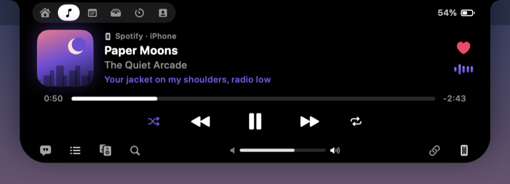
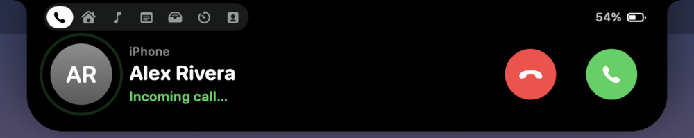
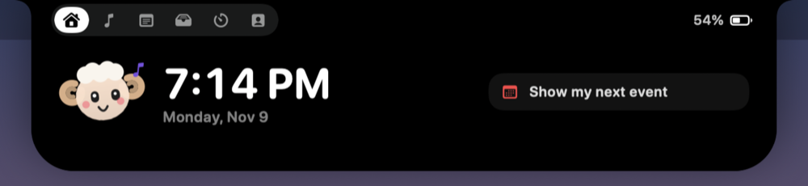
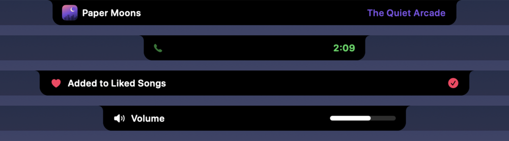

<div align="center">



# Aries Dynamic Island

**Your MacBook's notch, alive.**
A Dynamic Island for macOS, built around Spotify, with synced Apple Music–style lyrics, calls, notes, a file shelf, timers and a tiny ram who lives in your notch.

[Download](../../releases/latest) · [Features](#features) · [Install](#install) · [Spotify setup](#connect-spotify-phone-playback) · [Build from source](#build-from-source)

</div>

---

## Features

### 🎵 Music — designed around Spotify
- **Live in the notch:** album art on one side, a live visualizer on the other, and soft music notes that drift out while a song plays.
- **Hover to expand:** full player with scrubbing, shuffle, repeat, volume, and the current lyric line as it's sung.
- **Your iPhone too:** see and control what's playing on your phone, speaker or any Spotify Connect device.
- **Like songs** ❤️ straight to Liked Songs (or Favorites in Apple Music) with ⌥⌘K.
- **Up Next & Recently Played** from Spotify, and tap any song to play it.
- **Play on…:** move playback between your phone, Mac and speakers.
- **Search Spotify** and play anything without leaving what you're doing.
- **Song announcements:** a quick bump in the notch when the track changes.
- **Lock Screen & Control Center:** music playing on your phone also shows up in macOS's own Now Playing, and your keyboard's ⏯ keys control it.
- Works with **Spotify** and **Apple Music** on your Mac at the same time; you pick which one wins.


### 🎤 Full-screen lyrics, Apple Music style
- Big, bold synced lyrics: **words light up as they're sung**, and lines glide into place in a staggered wave.
- A slowly flowing colour background made from the album art.
- Instrumental breaks show the breathing **• • •** dots.
- Click a line to jump to it. Scroll to look around and it glides back.
- Switch between **Lyrics**, **Up Next**, and a **full-screen album-art player**.
- Keys: space play/pause · ← → skip · ↑ ↓ volume · esc close.


### 📞 Calls
- Live call timer in the notch for FaceTime, iPhone calls (Continuity), Zoom, Teams, Discord, Slack huddles, Webex, WhatsApp and more.
- **Mute / unmute** your mic from the notch (or ⌥⌘M anywhere).
- **Incoming iPhone calls** pop open the island so you can answer or decline (needs Accessibility, see [Privacy](#privacy--permissions)).



### 🏠 Everything else
| | |
|---|---|
| **Home** | Clock, date, weather, your next calendar event with a **Join** button for Zoom/Meet/Teams, and open to-dos |
| **Aries** 🐏 | A tiny ram on Home. Blinks, follows your cursor, bobs to your music, gets sleepy at night. Tap to boop. |
| **Notes** | Quick notes and to-dos. Pin, check off, copy. ⌥⌘N from anywhere. |
| **Shelf** | Drag files onto the notch, then drag them out later or AirDrop them. |
| **Timer** | Presets or custom. Countdown ring in the notch, a chime and confetti when done. Can double as a music sleep timer. |
| **Mirror** | Quick camera check before a call. The camera turns off the moment the island closes. |
| **Clipboard** | Optional history of copied text (memory only, skips password managers). |
| **Popups** | Volume, AirPods/headphones connecting, charging, low battery, mic/camera in use, meeting heads-up, unlock greeting. |

<p>


</p>


### ✨ Welcome to Aries
On first launch, *Welcome to Aries* is hand-written across the screen in cursive, inspired by Apple's "hello". A short tour then sets up music, calendar, weather and calls, and ends with a ✓ confirmation.


### ⌨️ Keyboard shortcuts
| Shortcut | Action |
|---|---|
| ⌥⌘I | Open / close the island |
| ⌥⌘P | Play / pause |
| ⌥⌘L | Full-screen lyrics |
| ⌥⌘N | New note |
| ⌥⌘M | Mute / unmute microphone |
| ⌥⌘K | Like current song |

---

## Install

1. Download **Aries-Dynamic-Island.zip** from the [latest release](../../releases/latest) and unzip it.
2. Drag **Aries Dynamic Island.app** to **Applications**.
3. The app isn't notarized by Apple yet, so the first time, **right-click it → Open → Open**.
   If macOS still blocks it, go to **System Settings → Privacy & Security** and click **Open Anyway**.
4. Follow the welcome tour. When asked, allow Aries to control **Spotify** and **Music**.

**Requires** macOS 14 Sonoma or later. Made for MacBooks with a notch, and works on other Macs and external displays as a floating island.
If you use another notch app (NotchNook, boring.notch, Sapphire…), quit it so they don't overlap.

## Connect Spotify (phone playback)

Your phone's Spotify reports to Spotify's servers, and Aries reads it from there. Spotify asks each person to use their own free developer key:

1. Open the [Spotify Developer Dashboard](https://developer.spotify.com/dashboard) and click **Create app** (any name).
2. Add this **Redirect URI**: `http://127.0.0.1:8898/callback`, and tick **Web API**.
3. Copy the **Client ID**, paste it into **Aries Settings → iPhone · Spotify Connect**, then click **Connect Spotify**.

Notes:
- Controlling phone playback (pause, skip, seek, switching devices) needs **Spotify Premium**. That's Spotify's rule.
- Sign-in uses OAuth PKCE, so no client secret is stored. The refresh token lives in your macOS Keychain.
- Apple Music on iPhone can't be read from a Mac, so phone playback works with Spotify only.

## Privacy & permissions

Aries has no accounts, analytics or servers of its own. Everything stays on your Mac, except these direct requests:

| Talks to | Why |
|---|---|
| Spotify Web API | Phone playback, likes, queue, devices, search (only if you connect) |
| [LRCLIB](https://lrclib.net) | Synced lyrics (song title + artist) |
| iTunes Search API | Album art when a track has none |
| [Open-Meteo](https://open-meteo.com) | Weather for the city you choose |

| Permission | Used for |
|---|---|
| Automation (Spotify, Music) | Reading and controlling what's playing on your Mac |
| Calendars | Next event and meeting heads-up (optional) |
| Accessibility | Answer/decline iPhone calls and end calls from the notch (optional) |
| Camera | Mirror tab only, and only while it's open |

Mic and camera *indicators* only check whether a device is in use. Aries never records audio or video.

## Build from source

Requires Xcode or the Xcode Command Line Tools (Swift 5.10+).

```bash
git clone <this repo>
cd aries-dynamic-island
./build.sh --install     # builds, copies to /Applications and launches
```

- `./build.sh` builds `build/Aries Dynamic Island.app`
- `./build.sh --zip` also makes a release zip
- Pushing a tag like `v1.0.0` runs GitHub Actions to build and attach the zip to a release.
- `"build/Aries Dynamic Island.app/Contents/MacOS/Aries" --snapshot ./shots` renders every screen with demo content (that's how the screenshots above were made).

### Project layout
```
Sources/Aries/
  App.swift              app delegate, menu bar item, windows, shortcuts
  IslandPanel.swift      the notch window and mouse handling
  IslandModel.swift      island state: tabs, popups, calls, sizes
  IslandView.swift       island UI: compact states, Home, Shelf, Timer
  MusicTab.swift         music player, queue, devices, search
  LyricsView.swift       full-screen Apple Music–style player & lyrics
  MusicController.swift  merges Spotify, Apple Music and phone playback
  LocalPlayers.swift     AppleScript bridge to Spotify / Music
  SpotifyWeb.swift       Spotify Web API (PKCE sign-in, library, devices)
  NowPlayingBridge.swift phone playback → macOS lock screen & media keys
  Lyrics.swift           LRCLIB lyrics + LRC parsing
  Calls.swift            call detection, answer/decline, mic mute
  Tools.swift            notes, clipboard, weather, mirror, hotkeys
  ToolTabs.swift         Notes, Clipboard, Mirror and Call tabs
  Features.swift         shelf, timer, calendar, audio devices
  SystemMonitor.swift    mic, camera, battery
  Buddy.swift            Aries the ram + confetti
  Welcome.swift          cursive welcome and onboarding
  SettingsView.swift     settings window
```

## Known limitations
- macOS has no public call API, so call detection is based on which app is using the microphone, and answering calls relies on the system's call banner. Both are best-effort.
- Apps can't draw on the macOS lock screen. Aries publishes phone playback to macOS's own Now Playing instead, which the lock screen shows.
- Word-by-word lyric highlighting is estimated from line timings, because LRCLIB provides line-level sync.
- Not notarized yet. See [Install](#install).

## License

[MIT](LICENSE). Lyrics are provided by LRCLIB and remain the property of their owners. Spotify and Apple Music are trademarks of their respective owners; this project isn't affiliated with either.
