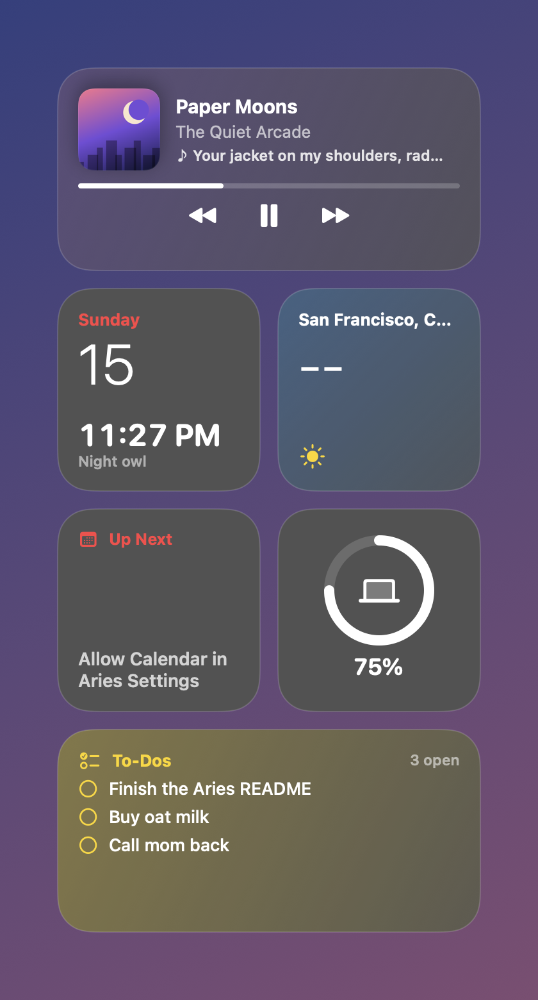
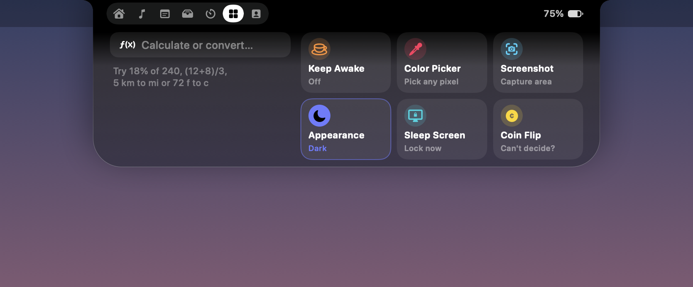
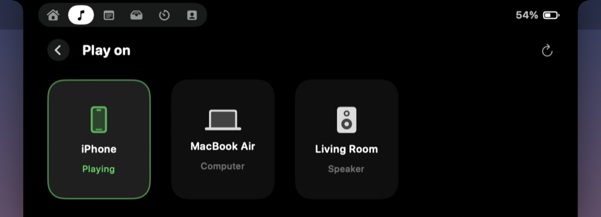
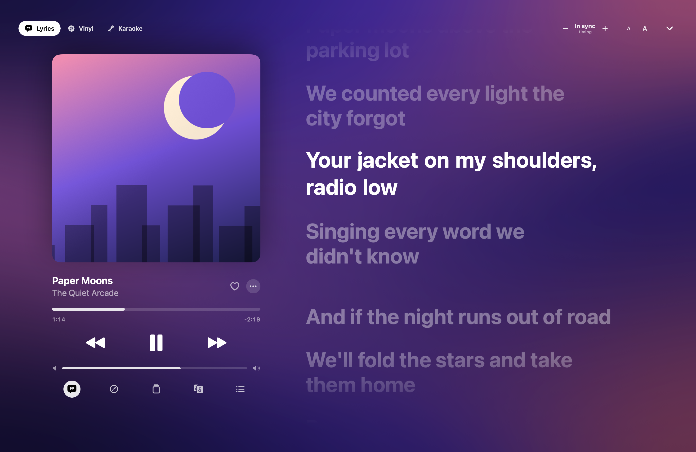
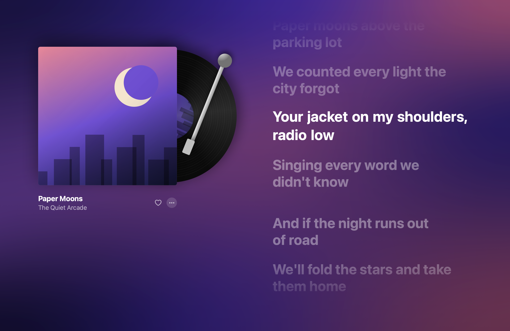
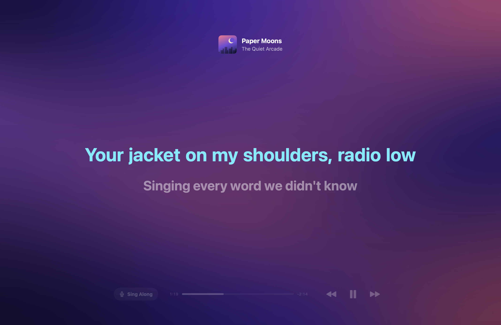
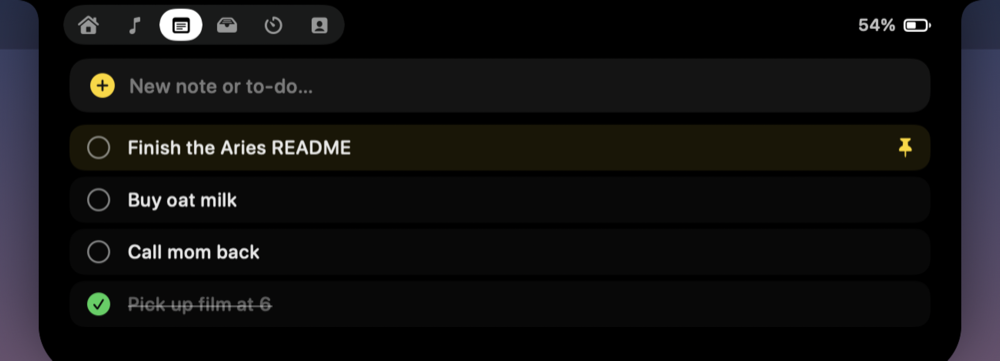
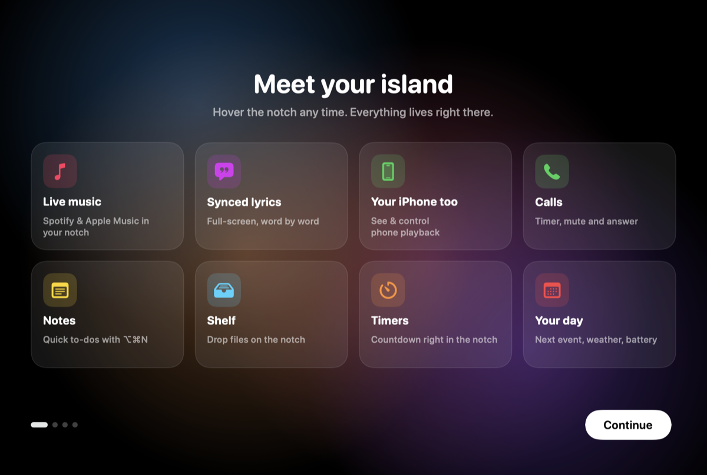
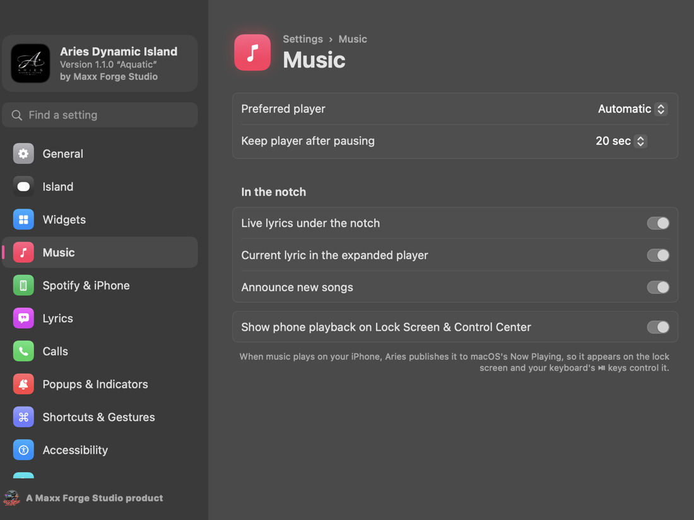

<div align="center">


# Aries Dynamic Island 2.0 “Aquatic”

**Your MacBook's notch, alive.** The iPhone's Dynamic Island, rebuilt for the Mac: music, karaoke lyrics, calls, Focus, widgets and tools, all living in your notch.

[](../../releases/latest)


<sub>A <b>Maxx Forge Studio</b> product</sub>


A Dynamic Island for macOS, built around Spotify, with synced Apple Music–style lyrics, calls, notes, a file shelf, timers and a tiny ram who lives in your notch.

[Download](../../releases/latest) · [Features](#features) · [Install](#install) · [Spotify setup](#connect-spotify-phone-playback) · [Build from source](#build-from-source)

</div>

---

## ✨ What's new in 2.0 “Aquatic”, the biggest Aries update yet

| | |
|---|---|
| 🎤 **Lyrics, reimagined** | Three full-screen styles: Apple Music–style **Lyrics**, a spinning **Vinyl** record that slides out of its sleeve, and **Karaoke**. |
| 🎶 **Karaoke with a score** | Huge two-line karaoke, a 3-2-1 countdown before the vocals, and **Sing Along** scoring from your mic. |
| 🟢 **Deeper Spotify** | Artist pages (follow, popular songs), full album tracklists, **Add to Playlist**, **Play Next** and Recently Played, right from the lyrics screen. |
| 🎯 **Lyrics that stay in sync** | All-new timing engine keeps every word on the beat. Nudge any song with − / + and Aries remembers it. |
| 🌊 **Aquatic & Crystal glass** | A see-through glass island, like Apple's Liquid Glass. |
| 🖼️ **Living album art** | Artwork that gently moves while you listen, over a flowing background made from its colours. |
| 🔒 **Lock Screen widgets** | Control what's playing and see weather, your next event and battery while your Mac is locked. |
| 🧩 **Desktop widgets** | Now Playing, Clock, Weather, Up Next, Battery and To-Dos on your wallpaper. |
| 🌙 **Focus modes** | The island lights up when Do Not Disturb, Work, Sleep or any Focus turns on, just like iPhone. |
| 🧰 **New Tools tab** | Calculator & unit converter, Keep Awake, Color Picker, Screenshot, Dark Mode switch and a Coin Flip. |
| 📞 **FaceTime & instant calls** | Rings the instant a call comes in and knows FaceTime Audio, FaceTime Video and iPhone calls. |
| 📱 **More iPhone moments** | Caps Lock, Low Power Mode and offline alerts, and a second activity splits into its own bubble. |
| ⚡ **Live Activities for everything** | Shortcuts, scripts and apps can put their own activity in the island with an `aries://` link. |
| 🐏 **Meet the new Aries** | The ram got a full makeover, with headphones, moods and hearts. |
| 🔄 **Automatic updates** | Aries keeps itself up to date and shows you what's new after every update. |

<p align="center">


</p>


## Features

### 🎵 Music — designed around Spotify
- **Live in the notch:** album art on one side, a live visualizer on the other, and soft music notes that drift out while a song plays.
- **Hover to expand:** full player with scrubbing, shuffle, repeat, volume, and the current lyric line as it's sung.
- **Your iPhone too:** see and control what's playing on your phone, speaker or any Spotify Connect device.
- **Like songs** ❤️ straight to Liked Songs (or Favorites in Apple Music) with ⌥⌘K.
- **Up Next & Recently Played** from Spotify, and tap any song to play it.
- **Play on…:** move playback between your phone, Mac and speakers.
- **Search Spotify** and play anything without leaving what you're doing.
- **Song announcements:** a quick bump in the notch when the track changes.
- **Lock Screen & Control Center:** music playing on your phone also shows up in macOS's own Now Playing, and your keyboard's ⏯ keys control it.
- Works with **Spotify** and **Apple Music** on your Mac at the same time; you pick which one wins.



### 🎤 Full-screen lyrics, Apple Music style
- Big, bold synced lyrics: **words light up as they're sung**, and lines glide into place in a staggered wave.
- A slowly flowing colour background made from the album art.
- Instrumental breaks show the breathing **• • •** dots.
- Click a line to jump to it. Scroll to look around and it glides back.
- Three styles: **Lyrics** (Apple Music), **Vinyl** (a spinning record with a tonearm) and **Karaoke** (big centred lines with a countdown and Sing Along scoring).
- **Living album art** and a flowing background made from the artwork's colours.
- Lyrics a little early or late? Nudge them with **− / +** (or `[` `]`), saved per song.
- Right-click a line to copy it, or copy all the lyrics from the ••• menu.
- Switch between **Lyrics**, **Up Next**, and a **full-screen album-art player**.
- Keys: 1 2 3 styles · space play/pause · ← → skip · ↑ ↓ volume · − + text size · esc close.







### 📞 Calls
- Live call timer in the notch for FaceTime, iPhone calls (Continuity), Zoom, Teams, Discord, Slack huddles, Webex, WhatsApp and more.
- **Mute / unmute** your mic from the notch (or ⌥⌘M anywhere).
- **Incoming iPhone calls** pop open the island so you can answer or decline (needs Accessibility, see [Privacy](#privacy--permissions)).


### 🏠 Everything else
| | |
|---|---|
| **Home** | Clock, date, weather, your next calendar event with a **Join** button for Zoom/Meet/Teams, and open to-dos |
| **Aries** 🐏 | A tiny ram on Home. Blinks, follows your cursor, bobs to your music, gets sleepy at night. Tap to boop. |
| **Notes** | Quick notes and to-dos. Pin, check off, copy. ⌥⌘N from anywhere. |
| **Shelf** | Drag files onto the notch, then drag them out later or AirDrop them. |
| **Timer** | Presets or custom. Countdown ring in the notch, a chime and confetti when done. Can double as a music sleep timer. |
| **Tools** | Calculator and unit converter (`18% of 240`, `5 km to mi`), Keep Awake, Color Picker, Screenshot, Light/Dark switch, Sleep Screen and a Coin Flip. |
| **Mirror** | Quick camera check before a call. The camera turns off the moment the island closes. |
| **Clipboard** | Optional history of copied text (memory only, skips password managers). |
| **Popups** | Volume, AirPods/headphones connecting, charging, low battery, mic/camera in use, meeting heads-up, unlock greeting. |

<p>


</p>


### 🎬 Brand intro
"Aries Dynamic Island" writes itself in cursive and flows into the chrome Aries logo, in the spirit of Apple's "hello". It plays when you first open Aries, and is also available as video: [16:9](docs/media/Aries-Intro-16x9.mp4) · [9:16 for Reels/TikTok](docs/media/Aries-Intro-9x16.mp4).

### 🔐 Privacy & Permissions
Aries asks for each permission only when a feature you turned on needs it, shows anything still missing in Settings and on the What's New page, and takes you straight to the right spot in System Settings.

### ✨ Welcome to Aries
On first launch, *Welcome to Aries* is hand-written across the screen in cursive, inspired by Apple's "hello". A short tour then sets up music, calendar, weather and calls, and ends with a ✓ confirmation.



### ⚙️ Settings


### ⌨️ Keyboard shortcuts & gestures
| Shortcut | Action |
|---|---|
| ⌥⌘I | Open / close the island |
| ⌥⌘P | Play / pause |
| ⌥⌘L | Full-screen lyrics |
| ⌥⌘N | New note |
| ⌥⌘M | Mute / unmute microphone |
| ⌥⌘K | Like current song |
| Two-finger swipe on the island | Next / previous song |
| Two-finger scroll on the island | Volume |

---

## Install

1. Download the **Aries-Dynamic-Island .zip** from the [latest release](../../releases/latest) and unzip it.
2. Drag **Aries Dynamic Island.app** to **Applications**.
3. The app isn't notarized by Apple yet, so the first time, **right-click it → Open → Open**.
   If macOS still blocks it, go to **System Settings → Privacy & Security** and click **Open Anyway**.
4. Follow the welcome tour, and when asked, allow Aries to control **Spotify** and **Music**.
5. That's it. From now on Aries keeps itself up to date (Settings → Software Update).

**Or with Homebrew:**

```bash
brew install --cask maxxforgestudio-del/tap/aries-dynamic-island
```

Website: **https://maxxforgestudio-del.github.io/aries-dynamic-island/**

**Requires** macOS 14 Sonoma or later. Made for MacBooks with a notch, and works on other Macs and external displays as a floating island.
If you use another notch app (NotchNook, boring.notch, Sapphire…), quit it so they don't overlap.

## Connect Spotify (phone playback)

Your phone's Spotify reports to Spotify's servers, and Aries reads it from there. Spotify asks each person to use their own free developer key:

1. Open the [Spotify Developer Dashboard](https://developer.spotify.com/dashboard) and click **Create app** (any name).
2. Add this **Redirect URI**: `http://127.0.0.1:8898/callback`, and tick **Web API**.
3. Copy the **Client ID**, paste it into **Aries Settings → iPhone · Spotify Connect**, then click **Connect Spotify**.

Notes:
- Controlling phone playback (pause, skip, seek, switching devices) needs **Spotify Premium**. That's Spotify's rule.
- Sign-in uses OAuth PKCE, so no client secret is stored. The refresh token lives in your macOS Keychain.
- Apple Music on iPhone can't be read from a Mac, so phone playback works with Spotify only.

## Privacy & permissions

Aries has no accounts, analytics or servers of its own. Everything stays on your Mac, except these direct requests:

| Talks to | Why |
|---|---|
| Spotify Web API | Phone playback, likes, queue, devices, search (only if you connect) |
| [LRCLIB](https://lrclib.net) | Synced lyrics (song title + artist) |
| iTunes Search API | Album art when a track has none |
| [Open-Meteo](https://open-meteo.com) | Weather for the city you choose |
| GitHub Releases | Checking for app updates (can be turned off) |

| Permission | Used for |
|---|---|
| Automation (Spotify, Music) | Reading and controlling what's playing on your Mac |
| Calendars | Next event and meeting heads-up (optional) |
| Accessibility | Answer/decline iPhone calls and end calls from the notch (optional) |
| Camera | Mirror tab only, and only while it's open |
| Downloads folder | Download progress (optional, off by default) |

Mic and camera *indicators* only check whether a device is in use. Aries never records audio or video.

## Build from source

Requires Xcode or the Xcode Command Line Tools (Swift 5.10+).

```bash
# Maxx Forge Studio team only (the source is proprietary — see LICENSE)
git clone https://github.com/maxxforgestudio-del/aries-dynamic-island.git
cd aries-dynamic-island
./build.sh --install     # builds, copies to /Applications and launches
```

- `./build.sh` builds `build/Aries Dynamic Island.app`
- `./build.sh --zip` also makes a release zip
- To publish a release: `./build.sh --zip`, then `gh release create vX.Y.Z build/*.zip`
- `"build/Aries Dynamic Island.app/Contents/MacOS/Aries" --snapshot ./shots` renders every screen with demo content (that's how the screenshots above were made).
- `"build/Aries Dynamic Island.app/Contents/MacOS/Aries" --render-intro ./media` renders the brand intro to MP4 (16:9 and 9:16) and GIF.

### Project layout
```
Sources/Aries/
  App.swift              app delegate, menu bar item, windows, shortcuts
  IslandPanel.swift      the notch window and mouse handling
  IslandModel.swift      island state: tabs, popups, calls, sizes
  IslandView.swift       island UI: compact states, Home, Shelf, Timer
  MusicTab.swift         music player, queue, devices, search
  LyricsView.swift       full-screen Apple Music–style player & lyrics
  MusicController.swift  merges Spotify, Apple Music and phone playback
  LocalPlayers.swift     AppleScript bridge to Spotify / Music
  SpotifyWeb.swift       Spotify Web API (PKCE sign-in, library, devices)
  NowPlayingBridge.swift phone playback → macOS lock screen & media keys
  Updater.swift          GitHub release updates + What's New
  Downloads.swift        download progress from ~/Downloads
  Lyrics.swift           LRCLIB lyrics + LRC parsing
  Calls.swift            call detection, answer/decline, mic mute
  Tools.swift            notes, clipboard, weather, mirror, hotkeys
  ToolTabs.swift         Notes, Clipboard, Mirror and Call tabs
  QuickTools.swift       Tools tab: calculator, converter, keep awake, color picker…
  Features.swift         shelf, timer, calendar, audio devices
  SystemMonitor.swift    mic, camera, battery
  Buddy.swift            Aries the ram + confetti
  Welcome.swift          cursive welcome and onboarding
  SettingsView.swift     settings window
```

## Known limitations
- macOS has no public call API, so call detection is based on which app is using the microphone, and answering calls relies on the system's call banner. Both are best-effort.
- Apps can't draw on the macOS lock screen. Aries publishes phone playback to macOS's own Now Playing instead, which the lock screen shows.
- Word-by-word lyric highlighting is estimated from line timings, because LRCLIB provides line-level sync.
- Not notarized yet. See [Install](#install).

## License

**© 2026 Maxx Forge Studio. All rights reserved.** Aries Dynamic Island is free to download and use, but the source code, design, names and logos are proprietary to Maxx Forge Studio and may not be copied, modified or redistributed. See [LICENSE](LICENSE).

Lyrics are provided by LRCLIB and remain the property of their owners. Spotify and Apple Music are trademarks of their respective owners; Aries isn't affiliated with either.

<div align="center"><br><sub>A Maxx Forge Studio product</sub></div>
